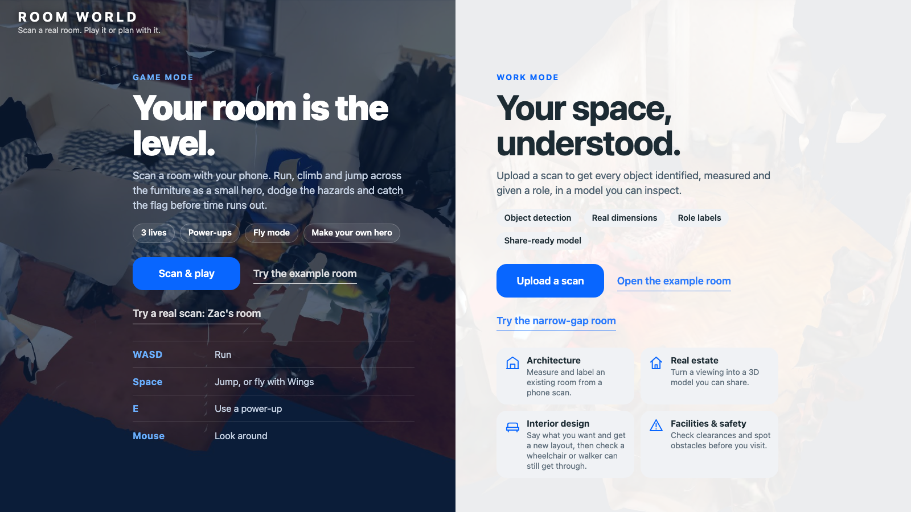
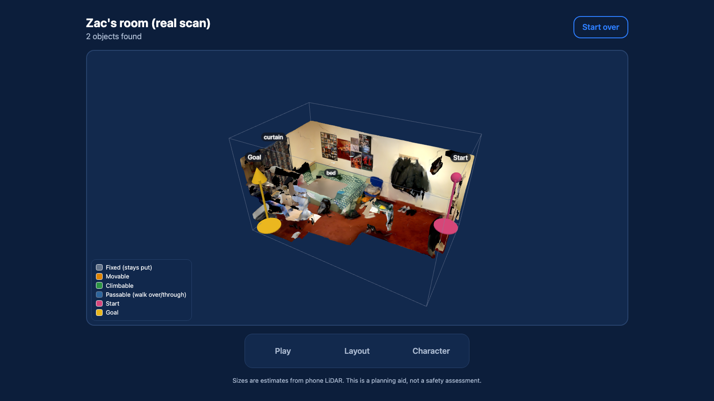
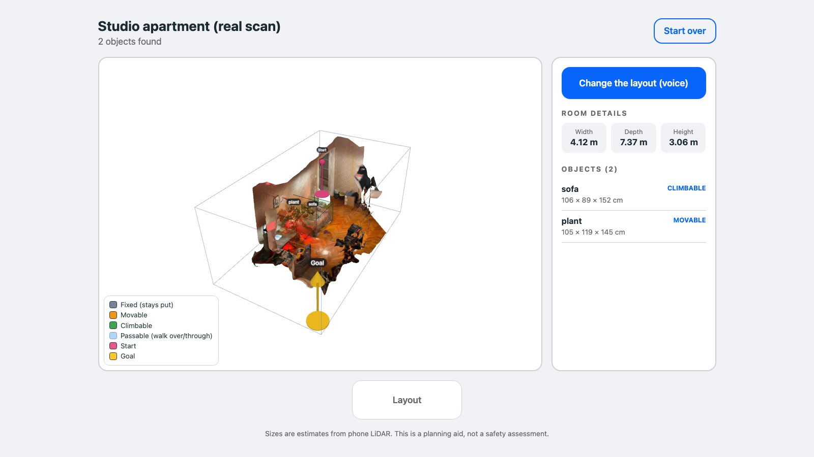
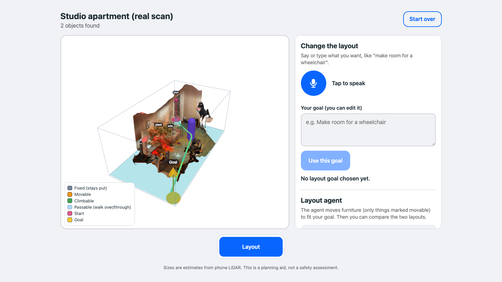
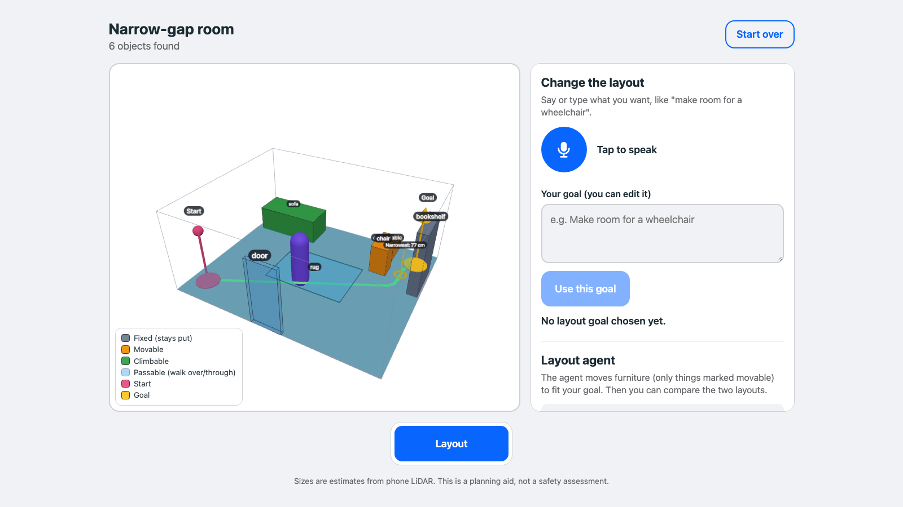
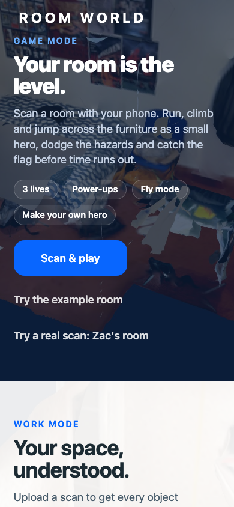
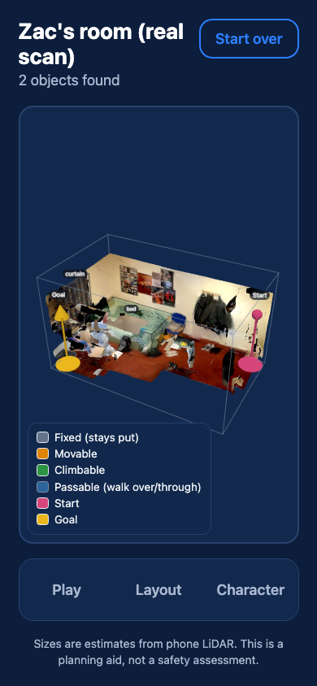
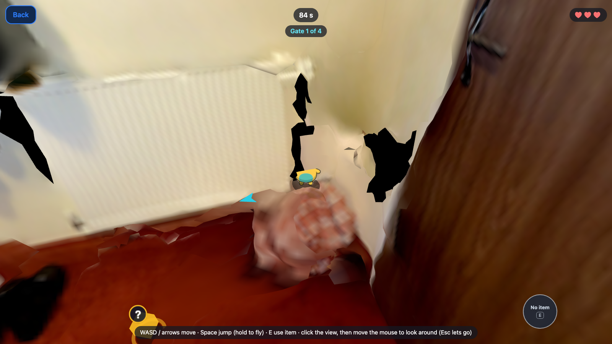
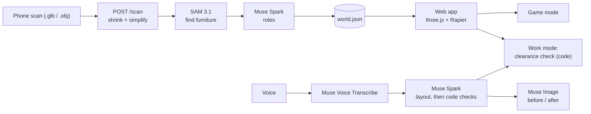

<div align="center">

# Room world

**Scan a real room with your phone and get a labelled 3D world you can race through, or use to check that everyone can get around it.**

[](https://github.com/aluinn/meta-developer-hackathon/actions/workflows/ci.yml)
[](https://github.com/aluinn/meta-developer-hackathon/actions/workflows/codeql.yml)
[](LICENSE)
[](https://github.com/aluinn/meta-developer-hackathon/stargazers)
[](https://render.com/deploy?repo=https://github.com/aluinn/meta-developer-hackathon)

<!--
  HERO PLACEHOLDER: replace the screenshot below with a short screen recording (GIF or MP4) of
  scan -> labelled room -> race, saved as e.g. docs/assets/room-world-demo.gif. Until then this is a real screenshot.
-->


[**Try it live**](https://room-world-server.onrender.com) · [Deploy](docs/deployment.md) · [Architecture](docs/architecture.md) · [Roadmap](ROADMAP.md) · [Contributing](CONTRIBUTING.md)

</div>

Built by **Aluinn McDonald** and **Zac Beaumont** for the Meta Global AI Developer Hackathon (Indie track). The live site is on a free host that sleeps, so the first load can take about a minute. No sign-in.

## Features

- **Scan to world.** Upload a `.glb` or `.obj` room scan (up to 100 MB). The server finds the furniture, decides which pieces can move, be climbed or be walked over, and returns a `world.json` the browser turns into a 3D room.
- **Game mode.** Race a tiny character through checkpoint gates, item boxes and patrolling hazards in your real room, with three lives, power-ups and fly mode. On a scan, the character runs on the scan's own triangles rather than on boxes.
- **Make your own character.** Describe a hero in a few words and Muse Image draws one for Game mode.
- **Work mode: clearance check.** Pick who is walking (0.5 m, 0.7 m, wheelchair 0.85 m, or any width). Plain code finds the widest route from Start to Goal, shows the route and the narrowest gap, and shows where it is blocked.
- **Layout agent by voice or text.** Say "make room for a wheelchair". Speech becomes text, Muse Spark proposes moves for movable furniture, code validates them, and you get a new layout, a reason for each change, and before and after pictures.
- **Scan match score.** How closely the simulated boxes match what SAM saw in the real scan. Plain code, no AI.
- **Ready-made rooms, no key needed.** Zac's room and a studio apartment (real scans), a made-up example room, and a narrow-gap room with a 77 cm gap that blocks a wheelchair.
- **Phone and laptop.** Touch controls and keyboard controls; scans are shrunk and one job runs at a time so it fits a free 512 MB host.

## Screenshots

| Game mode: pick a room | Work mode: studio apartment scan |
|---|---|
|  |  |
| **Work mode: layout panel** | **Work mode: narrow-gap room** |
|  |  |

<details>
<summary>More: phone and play mode</summary>

| Phone: front page | Phone: a scanned room | Play mode (Zac's room) |
|---|---|---|
|  |  |  |

Screenshots are taken with headless Chrome using software 3D rendering, so they look softer than on a real GPU.

</details>

## How it works



1. **Upload and shrink.** The server simplifies the scan so it fits a small host; each job runs in its own process so memory is returned afterwards.
2. **Find and label.** It renders 8 views of the room, asks SAM 3.1 for each kind of furniture, and projects the outlines back onto the 3D mesh. A surface needs votes from 2 or more views, so one wrong view is outvoted. Muse Spark then gives each object a role.
3. **One handover file.** The result is [`shared/world.schema.json`](shared/world.schema.json)-valid `world.json`: metres, y up, a room, objects (`id`, `label`, `role`, `confidence`, `position`, `size`, `rotation_y`), a spawn and a goal. The server writes it; the web app only reads it.
4. **Models propose, code checks.** Every model answer is validated before it reaches you, and the clearance numbers and the match score involve no AI at all (table in [AI tools used](#ai-tools-used)). Full detail in [docs/architecture.md](docs/architecture.md), with a shorter tour and the failure modes in [docs/system-overview.md](docs/system-overview.md); the clearance maths is in [docs/clearance.md](docs/clearance.md).

## Quick start

You need Git, Node.js (the checks here ran on v24; the Dockerfile builds with Node 22) and Python 3.11+ (checked on 3.12).

```bash
git clone https://github.com/aluinn/meta-developer-hackathon.git
cd meta-developer-hackathon

# Web app
cd web && npm install && npm run dev        # http://localhost:5173

# Server (second terminal)
cd server
python3 -m venv .venv && source .venv/bin/activate      # Windows: py -m venv .venv ; .venv\Scripts\Activate.ps1
pip install -r requirements.txt
cp ../.env.example .env                                  # then put your own MODEL_API_KEY in it
uvicorn main:app --reload --port 8000                    # http://localhost:8000/health
```

The ready-made rooms work without a key or a server. Scanning, voice, the layout agent and the character maker need a `MODEL_API_KEY` from the [Meta developer portal](https://dev.meta.ai). Never commit `.env`. To try on a phone on the same Wi-Fi: `npm run dev -- --host`.

| Command | Where | What it does |
|---|---|---|
| `npm run dev` | `web/` | Dev server with hot reload |
| `npm run build` | `web/` | Type-check, then build to `web/dist` |
| `npx tsc --noEmit` | `web/` | Type-check only |
| `for f in scripts/test-*.ts; do node $f; done` | `web/` | Web logic tests (plain Node, no browser) |
| `uvicorn main:app --reload --port 8000` | `server/` | API server (docs at `/docs`) |
| `for f in scripts/test_*.py; do python $f; done` | `server/` | Server tests with fake AI answers: no key, no cost |

To run like the deployed site (one server for site and API): `cd web && npm run build`, then run `uvicorn main:app --port 8000` in `server/` and open http://localhost:8000.

## Deploy

One Docker image serves the API and the website. [`render.yaml`](render.yaml) is a Render Blueprint: **New > Blueprint > pick this repo**, then set `MODEL_API_KEY` (and `ALLOWED_ORIGINS` only if the site is hosted elsewhere) in Render's dashboard. Step by step in [docs/deployment.md](docs/deployment.md).

## AI tools used

### Meta models inside the running app (server side)

Each model below is called somewhere in `/server`. The key lives only in the server's `.env` or host secrets; the browser never sees it.

| Model | What it does here | Where |
|---|---|---|
| **SAM 3.1** (`sam-3.1`) | Finds and outlines furniture: 8 rendered views, one question per kind of object, outlines projected onto the 3D mesh | `server/labelling/sam.py` |
| **Muse Spark** (`muse-spark-1.3`) | Decides each object's role (fixed, movable, climbable, passable) and proposes new positions for the Layout agent, both as JSON | `server/labelling/roles.py`, `server/labelling/layout.py` |
| **Muse Image** (`muse-image-1.0`) | Draws before and after pictures of a layout change, and the player's character | `server/labelling/muse_image.py`, `server/photo_render.py`, `server/characters.py` |
| **Muse Voice Transcribe** (`muse-voice-transcribe-1.0`) | Turns the spoken layout request into text | `server/transcribe.py` |

### Development tool

Code was written with help from **Claude Code** (Anthropic). Design decisions, testing and review were done by the two authors. Each session's log in [BUILD_LOG.md](BUILD_LOG.md) says what the AI helped with.

### Models propose, code checks

| Step | The model proposes | Our code enforces |
|---|---|---|
| Finding furniture | 2D outlines per view | Outlines projected onto the 3D mesh; a surface needs votes from 2+ views |
| Roles | A role and a confidence per object | Must be one of the four roles; bad answers fall back to a low-confidence default; the result must match `shared/world.schema.json` |
| Layout | New x/z positions (and turns) for movable objects | Only movable objects; inside the room; no overlaps; one retry with the problems as feedback, then reject |
| Clearance | nothing | **The clearance check and the scan-match score are plain code. No AI is involved in those numbers.** |

## FAQ

**Do I need an API key?** Only for scanning your own room, voice, the Layout agent and the character maker. The four ready-made rooms and everything in the browser (viewer, play mode, clearance check) work without one.

**What files can I scan with?** `.glb` or `.obj`, up to 100 MB. The project was built around phone LiDAR scans exported from an external scanning app; the scanning itself is not part of this repo.

**Is the clearance check a safety or accessibility assessment?** No. Sizes and positions come from phone scans and AI labelling, so they are estimates. It is a planning aid and does not replace a cane, a guide dog or a professional assessment.

**Why did my scan find so few objects?** Only furniture the models can name is found, and objects are boxes. The two ready-made real scans show 2 objects each. Only `movable` objects move in a layout.

**Why is it slow?** On the free host a layout takes 30 to 100 seconds, one scan is processed at a time, and large scans are shrunk to fit 512 MB. The first visit after a quiet spell wakes the server.

**Does it cost anything to run?** Each model call uses Meta API credits. The project docs record about $0.25 for one scan, about $0.01 per character drawing. Those are the team's own figures from the hackathon, not re-measured here.

**Can I add a different scanner or model?** The contract is `world.json`. Anything that produces a schema-valid file can feed the web app.

## Good first issues

Drafts live in [`docs/issues/`](docs/issues/); copy one into a new issue, or ask for it to be opened.

| Issue draft | Label |
|---|---|
| [Add a "child" person preset](docs/issues/01-child-width-preset.md) | good first issue |
| [Unit tests for `formatSize`](docs/issues/02-test-format-size.md) | good first issue |
| [Document `world.json` field by field](docs/issues/03-document-world-json.md) | good first issue |
| [Record a demo GIF for the README](docs/issues/04-record-demo-gif.md) | good first issue |
| [Send `min_clearance_m` from the website](docs/issues/05-send-min-clearance.md) | enhancement |
| [Delete old scans automatically](docs/issues/06-expire-old-scans.md) | enhancement |
| [Show low-confidence objects differently](docs/issues/07-show-confidence.md) | enhancement |
| [Download the current `world.json`](docs/issues/08-download-world-json.md) | enhancement |
| [Test `/transcribe` on real speech and WebM](docs/issues/09-test-transcribe-webm.md) | enhancement |

## Roadmap

See [ROADMAP.md](ROADMAP.md).

## Credits

- **Authors:** Aluinn McDonald (server and AI pipeline) and Zac Beaumont (web app and simulation).
- **Meta models:** SAM 3.1, Muse Spark, Muse Image, Muse Voice Transcribe, via [Meta's OpenAI-compatible API](https://dev.meta.ai).
- **Libraries:** [three.js](https://threejs.org) (MIT), [Rapier](https://rapier.rs) (Apache-2.0), [Vite](https://vite.dev), [TypeScript](https://www.typescriptlang.org); [FastAPI](https://fastapi.tiangolo.com), [trimesh](https://trimesh.org), [NumPy](https://numpy.org), [SciPy](https://scipy.org), [Pillow](https://python-pillow.org). Every library with its licence is in [THIRD_PARTY.md](THIRD_PARTY.md).
- **Art:** original. The character was generated with Muse Image from the prompt in [docs/character-prompt.md](docs/character-prompt.md). The two example rooms are the authors' own scans.
- **Built with:** [Claude Code](https://claude.com/claude-code).

## Licence

[MIT](LICENSE) © 2026 Aluinn McDonald and Zac Beaumont.
