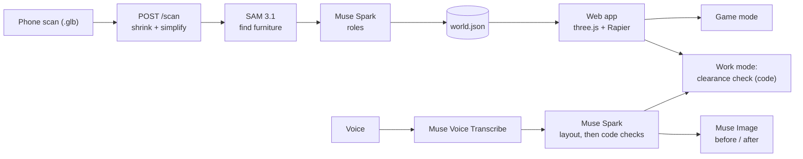

# Room world

**Scan a real room with your phone. Get a labelled 3D world you can race through, or use to plan a layout that everyone can get around.**

Built by Aluinn McDonald and Zac Beaumont for the Meta Global AI Developer Hackathon (Indie track).

**Try it: https://room-world-server.onrender.com** (no sign-in; the free host sleeps, so the first load can take a minute)

Pipeline: phone scan -> server (Meta AI models + our own checks) -> `world.json` -> web app (three.js + Rapier physics).

## What it does

Upload a scan (`.glb`, or drag it onto the page) and the server finds the furniture, works out which pieces can move, be climbed or be walked over, and builds a labelled 3D world. Two ways to use it:

| | Game mode | Work mode |
|---|---|---|
| For | Fun: your room becomes a playground | Planning: is this room easy to move around in? |
| What you do | Race a tiny character through gates, collect items, dodge hazards, with real physics on your real scan | Look at the labelled model, pick who is walking (Walking 0.5 m, Walker 0.7 m, Wheelchair 0.85 m, or any width) and see if they can get from Start to Goal |
| Voice | | Say what you want ("make the route wide enough for a wheelchair") and the Layout agent proposes moves, checked by code, with before and after pictures |
| Try without a scan | Zac's room (a real scan), or a made-up example room | A real studio apartment scan, or the narrow-gap room (a 77 cm gap that blocks a wheelchair) |

Highlights:
- **Real scan, real physics.** In a scan room the character runs on the scan's own triangles, not on boxes.
- **Clearance check.** Plain code measures the widest person who can walk the best route, shows the route, the narrowest gap and where it is blocked, and says "no gaps narrower than 120 cm" once a layout is roomy.
- **Layout agent by voice.** Speech -> text -> proposed moves -> validated moves -> a new world, with the reason for each change.
- **Scan match score.** How closely the simulation matches the real scan (plain code, not AI).
- **Make your own character** for Game mode from a short description.
- **Runs on a phone and a laptop**, and on a free 512 MB host (scans are shrunk, one job runs at a time, each in its own process).

## AI tools used

### Meta models inside the running app (server side)

Each model below is called somewhere in `/server` (checked in the code, not just planned). The key lives only in the server's `.env` / host secrets; the browser never sees it.

| Model | What it does for us | Where |
|---|---|---|
| **SAM 3.1** (`sam-3.1`) | Finds and outlines furniture in the scan: we render 8 views of the room, ask for each kind of object, and project the outlines back onto the 3D mesh | `server/labelling/sam.py` |
| **Muse Spark** (`muse-spark-1.3`) | Decides each object's role (fixed, movable, climbable, passable) and proposes new positions for the Layout agent, both as JSON | `server/labelling/roles.py`, `server/labelling/layout.py` |
| **Muse Image** (`muse-image-1.0`) | Draws the before and after pictures of a layout change, and the player's character | `server/labelling/muse_image.py`, `server/photo_render.py`, `server/characters.py` |
| **Muse Voice Transcribe** (`muse-voice-transcribe-1.0`) | Turns the spoken layout request into text | `server/transcribe.py` |

### Development tool

Code was written with help from **Claude Code** (Anthropic). All design decisions, testing and the final review were done by the two of us. Each session's log in [BUILD_LOG.md](BUILD_LOG.md) says what the AI helped with.

### Principle: models propose, code checks

Every model answer goes through our own validation before it reaches you:

| Step | The model proposes | Our code enforces |
|---|---|---|
| Finding furniture | 2D outlines per view | Outlines are projected onto the 3D mesh; a surface needs votes from 2+ views, so one wrong view is outvoted |
| Roles | A role and a confidence per object | The role must be one of the four; bad answers fall back to a low-confidence default; the result must match `shared/world.schema.json` |
| Layout | New x/z positions (and turns) for movable objects | Only movable objects; inside the room; no overlaps; one retry with the problems as feedback, then reject |
| Clearance | nothing | **The clearance check and the scan-match score are plain code. No AI is involved in those numbers.** |

## How it fits together

`shared/world.schema.json` is the handover between server and web: metres, y up, a room, a list of objects (`id`, `label`, `role`, `confidence`, `position`, `size`, `rotation_y`), a spawn and a goal. The server writes it; the web app only reads it. More in [docs/architecture.md](docs/architecture.md).

## Folders
- `web/` - Vite + TypeScript app (three.js, Rapier)
- `server/` - Python FastAPI server (the AI pipeline); serves the built website too
- `shared/` - `world.schema.json` + `example_world.json` (the contract between the two)
- `docs/` - architecture, deployment, demo script, character prompt

## Built with
three.js, Rapier (physics), Vite, TypeScript; FastAPI, trimesh, NumPy/SciPy, Pillow; Docker on Render. Meta's models are reached through the OpenAI-compatible Meta API. Every library and asset with its licence is in [THIRD_PARTY.md](THIRD_PARTY.md). The art (including the character) is original.

## Setup (once)

Install these, then close and reopen your terminal:

| Tool | Mac | Windows |
|---|---|---|
| Git | `xcode-select --install` or https://git-scm.com | https://git-scm.com/download/win |
| Node.js LTS | https://nodejs.org | https://nodejs.org |
| Python 3.11+ | https://python.org/downloads | https://python.org/downloads (tick "Add to PATH") |

Check: `git --version`, `node --version`, `python3 --version` (Windows: `py --version`).

Clone and install:

    git clone https://github.com/aluinn/meta-developer-hackathon.git
    cd meta-developer-hackathon
    cd web && npm install && cd ..

Server (Mac):

    cd server
    python3 -m venv .venv
    source .venv/bin/activate
    pip install -r requirements.txt

Server (Windows PowerShell):

    cd server
    py -m venv .venv
    .venv\Scripts\Activate.ps1
    pip install -r requirements.txt

If PowerShell blocks activation, run once: `Set-ExecutionPolicy -Scope CurrentUser RemoteSigned`.

API key: copy `.env.example` to `.env` and put in your own key (from the Meta developer portal). Never commit `.env`. Without a key the website still opens and the ready-made rooms work; scanning, voice and the Layout agent need the key.

## Run the web app

    cd web
    npm run dev

Open http://localhost:5173 - you should see "Room world".
To try on your phone (same Wi-Fi): `npm run dev -- --host`, then open the "Network" URL shown.
In development, the website sends its requests to the server on port 8000 (run the server too).

## Run the server

    cd server
    source .venv/bin/activate      # Windows: .venv\Scripts\Activate.ps1
    uvicorn main:app --reload --port 8000

Open http://localhost:8000/health - you should see `{"status":"ok"}`. API test page: http://localhost:8000/docs

## Run everything as one server (like the deployed site)

    cd web && npm run build
    cd ../server && source .venv/bin/activate && uvicorn main:app --port 8000

Open http://localhost:8000: the website, with the API at the same address. Deployment (Docker on Render) is in [docs/deployment.md](docs/deployment.md).

## Tests

Web (plain Node, no browser needed), from `web/`:

    npx tsc --noEmit
    for f in scripts/test-*.ts; do node $f; done

Server (these use fake AI answers, so they need no key and cost nothing), from `server/` with the venv active:

    for f in scripts/test_*.py; do python $f; done

## Honest limits
- Sizes and positions come from phone scans and AI labelling: a planning aid, not a safety or accessibility assessment.
- Only furniture the models can name is found; a scan can come back with few objects. Objects are boxes, and only movable ones move in a layout.
- A layout takes 30 to 100 seconds on the free host.
- The free host has 512 MB, so very large scans are shrunk, and one scan is processed at a time.

## Working together
Read [CONTRIBUTING.md](CONTRIBUTING.md). Log sessions in [BUILD_LOG.md](BUILD_LOG.md).
Third-party licences: [THIRD_PARTY.md](THIRD_PARTY.md). Code is MIT-licensed ([LICENSE](LICENSE)).
