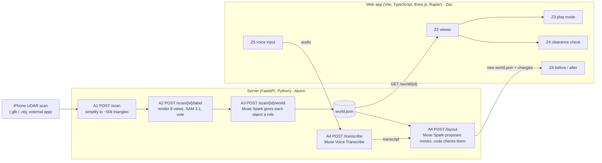

# Architecture

How Room world fits together. Status as of 2026-11-02: **A1 to A6 are built.** Proven on a real scan (a small bathroom, `shared/real_world_01.json`): A1 upload, A2 SAM labelling
(real SAM call, 29 s), A3 roles (real Muse Spark call, 8 s) and A6 `/score`. Image generation (the character) is proven too.
**Deployed on Render** (one service for site + API). On the live server, proven for real: scan upload and simplification, `/layout` (Muse Spark moved the coffee table
next to the sofa, accepted on the first attempt), `/transcribe` (call and stereo 48 kHz to 16 kHz conversion work; a test tone gave an empty transcript, as expected).
**Not yet run for real:** `/render` (needs a room photo), `/transcribe` on actual speech or on WebM/Ogg/MP4 (needs ffmpeg in the image), and anything on a furniture scan.

## The big picture



`shared/world.schema.json` is the handover. The server produces `world.json`; the web app only ever reads it.
Both sides can be built in parallel because `shared/example_world.json` is a valid stand-in.

## How the website uses the server
Choosing a scan file on the Upload screen runs `web/src/api.ts` `processScan()`: `POST /scan` (multipart field `file`), then
`POST /scan/{id}/label` (no body: the server's broad default prompts), then `POST /scan/{id}/world`, then `GET /world/{id}`, and the world.json that comes back is
shown by the existing viewer. The Loading screen shows a message before each step; failures become plain-English messages on the Upload screen
(wrong file type, over 100 MB, unreadable file, no furniture found, AI service problem, server unreachable). Addresses are relative (`/scan`), so it works the same on
the deployed site and, via the proxy in `web/vite.config.ts`, under `npm run dev`. One scan takes about 45 seconds and costs about $0.25 in Meta credits.
Not yet connected: Layout tab (`/layout`), voice (`/transcribe`), before/after (`/render`) and the score (`/score`). Test: `node web/scripts/test-api.ts`.

## The principle: models propose, code checks

Every Meta model call goes through our own validation before anything reaches the user or the web app:

| Step | The model proposes | Our code enforces |
|---|---|---|
| A2 labelling | 2D masks per view | masks are projected onto the 3D mesh; a surface needs votes from 2+ views, so one wrong view is outvoted |
| A3 roles | role + confidence per object | role must be one of the four; bad or missing answers fall back to a low-confidence default; output must validate against `world.schema.json` |
| A4 layout | new x/z (and turn) for movable objects | only `movable` objects; inside the room; no overlap with other solid objects; one retry with the problems as feedback, then reject (422) |

API keys stay on the server (`MODEL_API_KEY` in `.env`, git-ignored). The browser never sees them.

## Server endpoints (`/server`)

| Task | Endpoint | What it does | Needs key | Status |
|---|---|---|---|---|
| A1 | `POST /scan` | upload .glb/.obj (max 100MB), save, simplify, return `scan_id` + triangle counts | no | tested with generated meshes |
| A2 | `POST /scan/{scan_id}/label` | 8 virtual cameras, SAM 3.1 per view per prompt, project masks to 3D, vote, bounding boxes | yes (`sam-3.1`) | geometry/voting tested with a fake SAM; real SAM call proven on the bathroom scan |
| A3 | `POST /scan/{scan_id}/world` | Muse Spark assigns roles, builds and validates `world.json` | yes (`muse-spark-1.3`) | real Muse Spark call proven on the bathroom scan |
| A3 | `GET /world/{scan_id}` | returns the saved `world.json` | no | tested |
| A4 | `POST /transcribe` | browser audio -> transcript | yes (`muse-voice-transcribe-1.0`) | real call proven with a WAV tone (empty transcript); real speech and WebM untested |
| A4 | `POST /layout` | goal text + world -> new valid `world.json` + a reason per change | yes (`muse-spark-1.3`) | real model proven on the example world (first attempt accepted); validation/retry tested with a scripted stand-in |
| A5 | `POST /render`, `GET /render/{scan_id}/before\|after` | photo + old and new world -> before/after images (Muse Image edit, only moved objects change) | yes (`muse-image-1.0`) | request format, prompt and checks tested with a fake model; **real call untested** |
| A6 | `GET /score/{scan_id}` | scan-versus-simulation match score (outline of each world box vs SAM's mask of the real object) | no (default method) | proven on the bathroom scan (44%); the SAM-on-render option failed on real data |
| | `GET /health` | `{"status":"ok"}` | no | |

Interactive docs while the server runs: http://localhost:8000/docs

### Files kept per scan (`server/scans/<scan_id>/`, git-ignored)
`original.*` (upload), `simplified.glb` (A1), `views/` (A2 renders and per-pixel triangle ids), `labels.json` (A2),
`world.json` and `roles_detail.json` (A3), `layout.json` (A4, latest proposal), `render/before.png` and `render/after.png` (A5), `views/masks.npz` (every SAM mask from A2) and `score.json` (A6).

## The world.json contract
Metres, y-up. `position` is the box centre; `size` is [width x, height y, depth z] before rotation; `rotation_y` is in
radians, **positive = anticlockwise seen from above** (identical to three.js `rotation.y`; +90 degrees sends the box's local +x to world -z and local +z to world +x; the server uses the same matrix); `spawn`/`goal` are on the floor (`y = room.floor_y`, which is **not always 0** for real scans). Roles:
`fixed`, `movable`, `climbable`, `passable`. Details: `shared/world.schema.json`.

Things the web side should expect from real (not example) files:
- `rotation_y` is `0` for A3 output (A2 boxes are axis-aligned). A4 can add quarter turns.
- `confidence` = the lower of "how sure A2 is of the label" and "how sure Muse Spark is of the role". About 0.3 means a fallback guess.
- Sizes and positions are estimates from phone LiDAR. A planning aid, not a safety assessment.

## A4 contracts (Zac builds Z4, Z5 and Z6 against these)

**`POST /transcribe`** (Z5): multipart form with one file field named `audio`. Returns `{"transcript": "...", "duration_ms": 1234}`.
- Meta accepts **only WAV** (mono 16-bit PCM, 16 or 24 kHz, max 10 min / 32MB). Browsers record WebM/Ogg/MP4, not WAV.
- The server converts any 16-bit PCM WAV (any rate, mono or stereo) itself. For WebM/Ogg/MP4 it needs `ffmpeg` installed on the server host, otherwise it returns **415**.
- So the safest plan for Z5: encode WAV in the browser (e.g. record with Web Audio and write PCM samples), or we install ffmpeg wherever the server is deployed (A6).

**`POST /layout`** (Z4, Z6): JSON body
`{"scan_id": "<32 hex chars>", "goal": "put the table next to the sofa", "world": {...optional current world.json...}}`.
If `world` is omitted, the scan's saved `world.json` is used. Returns:
```json
{
  "scan_id": "...", "goal": "...",
  "world": { "...a complete, schema-valid world.json with the moves applied..." },
  "changes": [{"id": "table_1", "label": "table", "from": {"position": [..], "rotation_y": 0}, "to": {"position": [..], "rotation_y": 0}, "reason": "..."}],
  "notes": "anything the model could not do",
  "attempts": 1,
  "spawn_to_goal_walkable": {"before": true, "after": true}
}
```
- Only `movable` objects move. Nothing can be added or removed, so "add a desk" returns no changes plus an explanation in `notes`. The room data also has no windows.
- Errors: 422 if the model's proposal was rejected twice (body lists the problems; nothing changed) or the world is invalid; 503 if the server has no API key.
- `spawn_to_goal_walkable` is a rough 0.6 m-wide-person check on a 10 cm grid (`null` = could not tell). It is informational. Z4's clearance check is the real one.

## A5: before/after images and the character

**`POST /render`** (Z6): multipart form with `scan_id`, `photo` (JPEG/PNG/WebP of the room, max 15MB, shrunk to 1024 px),
`old_world` and `new_world` (both as JSON text; `new_world` is `/layout`'s `world`). The server works out which objects moved,
describes each move in plain words anchored on other objects (not coordinates, because Muse Image only sees the photo),
and asks `muse-image-1.0` (`POST /v1/images/edits`) to move only those and keep everything else. Returns:
```json
{
  "scan_id": "...", "before_url": "/render/<scan_id>/before", "after_url": "/render/<scan_id>/after",
  "moved": [{"id": "table_1", "label": "coffee table", "from": [..], "to": [..]}],
  "changed_fraction": 0.01, "likely_changed_too_much": false,
  "prompt": "the exact instruction sent to Muse Image"
}
```
- `before_url` / `after_url` are PNGs served by `GET /render/{scan_id}/before|after`.
- `changed_fraction` is a rough check of how much of the photo differs. If `likely_changed_too_much` is true, the model probably altered more than the moved objects: show a warning or re-run (results vary each time). `null` means the images could not be compared.
- The photo should show the moved objects and where they will go. If the new spot is out of frame, Muse Image cannot draw it.
- Only moves are supported: 422 if objects were added, removed or resized, or nothing moved. 415 for an unreadable photo (HEIC is not supported). 502 if Muse Image fails.

**Character image** (Z3): `server/scripts/make_character.py` generates an original character from the prompt in
`docs/character-prompt.md` and saves it to `web/public/assets/character.png` (white background removed). See that doc for status.

## A6: scan-versus-simulation score

**`GET /score/{scan_id}?method=silhouette|sam_on_render&refresh=true`** (Z6 can show it on the results screen) returns how well `world.json`
reproduces the scanned room:
```json
{
  "scan_id": "...", "method_name": "silhouette", "overall_percent": 44.2,
  "objects": [{"id": "toilet_1", "label": "toilet", "score_percent": 37.6, "views_compared": 5,
               "per_view": [{"view": 3, "iou": 0.321, "seen_in_scan": true, "seen_in_simulation": true}]}],
  "unmatched_scan_detections": [{"view": 0, "label": "sink", "pixels": 8780}],
  "warnings": [], "method": "...", "cached": false
}
```
Needs a labelled scan with a `world.json` (A2 and A3 first). The result is saved as `score.json` and served again until `labels.json` or `world.json`
change, or you pass `?refresh=true` (changing the scoring code does not invalidate the cache, so refresh after code changes).

**Method.** If `world.json` is a faithful copy of the room, what it draws should line up with what SAM found in the scan.
1. **Rebuild** the room from `world.json` alone: a floor, four walls, and each object as a box (position, size, `rotation_y`). Boxes get the scan's
   colour where A2 found that object (so a misplaced object still looks like itself), floor and walls the scan's floor and wall colours.
2. **Render** it from the same 8 cameras A2 used (positions in `labels.json`).
3. **Compare** with the masks A2 saved from the scan (`views/masks.npz`). For each world object and each view where it covers at least 300 pixels,
   take the SAM mask of that label on the scan that overlaps it most and compute **IoU** = intersection / union against the object's side of the render.
   - A view where SAM saw no object of that label in the scan is skipped (hidden or out of frame: nothing to compare against).
   - A view where SAM saw one but nowhere near the box counts as a miss (IoU 0).
4. **Per object** = mean IoU over its compared views, as a percentage. **Overall** = mean over scorable objects. Detections under 0.5 confidence are ignored.
5. **`unmatched_scan_detections`**: things SAM found in the scan that no world object accounts for (for example a missing object, or a mislabel).

**Two ways to get the simulation side (`method`)**
- **`silhouette` (default, free):** the box's own outline in the render. Works on real scans.
- **`sam_on_render` (about $0.16):** run SAM 3.1 on the render of the boxes and compare SAM's masks, as originally planned. **It does not work on a real scan:** on
  the real bathroom every object scored 0%, because SAM did not recognise plain grey boxes as a toilet or a sink (they were found in the real scan in 5 views each).
  The method only makes sense if the simulated render looks realistic. It is kept for completeness and for clean synthetic scenes.

**How to read it.**
- The score measures how well a box covers what SAM sees as the real object, not true sizes or positions. A box can never match a toilet exactly, so
  **real scores are low**: the bathroom's toilet scores about 38% and its sink about 51% (stable across views, so it is a real signal, not noise).
  Read scores relatively (this world vs a layout that moved things; one object vs the rest), not as a grade out of 100.
- In the offline test with fake SAM masks (10% of pixels dropped at random), a faithful world scores about 85%, one object moved 1.2 m drops that object to 0%,
  and a deleted object shows up as unmatched.
- Thin or small objects (rugs, doors) are judged on few pixels and are noisy. An object SAM never saw in the scan cannot be scored.
- A scan without colour gives a warning: SAM saw grey renders in A2.

## Deployment
`Dockerfile` + `render.yaml` run **one server for everything** on Render: the image builds the web app and FastAPI serves it at `/` with the API alongside
(API routes win; see `docs/deployment.md`). The web app should call the API with relative paths (`/layout`, not `http://localhost:8000/layout`).
Settings: `MODEL_API_KEY` (secret, set in the host's dashboard only), `ALLOWED_ORIGINS` (only needed if the web app is hosted elsewhere or during `npm run dev`; comma-separated; CORS allows only these),
optional `SCANS_DIR` (where scans are stored; default `server/scans`). The host's disk is temporary on the free plan, so scans do not survive a restart.

## Costs (from dev.meta.ai pricing, 2026-11-01)
SAM 3.1: $2.50 per 1,000 images; one A2 run is 64 requests (8 views x 8 prompts) = about $0.16. `/score` is free by default (only `method=sam_on_render` costs the same again).
Muse Image: $0.01 per generated image (one `/render` call = one image).
Muse Spark 1.3 (standard): $1.25 / $4.25 per million input / output tokens. Voice Transcribe: $0.18 per hour of audio.
We use **standard mode**, not `-contributor`, because contributor mode lets Meta train on our data.
Credits are $150 per person; each person claims their own.

## Known limits (say these in the demo)
- **Memory:** the server host has 512 MB. Scan textures are shrunk to 2048 px on load (`labelling/meshio.py`); without that, a typical phone scan with an 8192 x 2560 texture crashed the deployed server.
- **Scan quality decides everything.** The pipeline works on a clean, closed, box-shaped room (the bathroom scan: toilet and sink found in 5 views each,
  boxes on the right fixtures). It failed on a large open-plan room scan with a vaulted ceiling, big windows and outdoor ground in the mesh: SAM found only
  a plant. A2's cameras are placed from the scan's bounding box, so an irregular or partly-outdoor scan puts cameras outside the room, and the renders show the
  back of the mesh. Rescan smaller, simpler rooms, and look at `labels_overview.png` before trusting a result.
- A2 only finds what we ask SAM to look for (`prompts` in `POST /scan/{id}/label`; default is living-room furniture). A bathroom needs `["toilet", "sink", ...]`.
- A real scan's mesh is patchy, so A2 merges same-label patches whose boxes come within 5 cm. Two separate same-label objects touching each other would merge into one.
- Phone LiDAR sizes are approximate; all measurements are estimates.
- A2's boxes are axis-aligned, so rotated furniture gets a looser box.
- SAM sees colour renders of a simplified mesh, so it may miss small or dark objects.
- Muse Image edits are non-deterministic and may redraw more than asked or mis-place a moved object; `changed_fraction` is only a rough guard.
- Layout proposals respect geometry only, not taste or accessibility standards.
