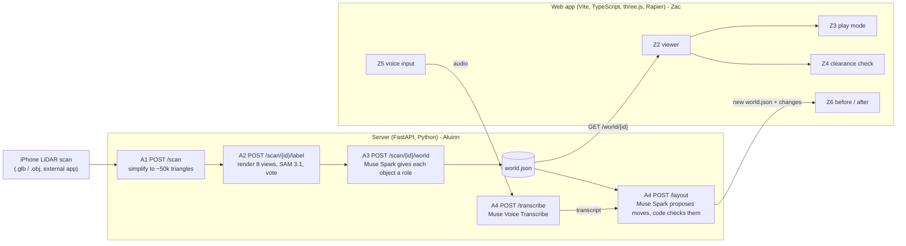

# Architecture

How Room world fits together. Status as of 2026-11-01: **A1 to A5 are built on `aluinn/start` and tested offline
only.** The real Meta calls (SAM, Muse Spark, Voice Transcribe) have not been run yet (no API key was available).

## The big picture



`shared/world.schema.json` is the handover. The server produces `world.json`; the web app only ever reads it.
Both sides can be built in parallel because `shared/example_world.json` is a valid stand-in.

## The principle: models propose, code checks

Every Meta model call goes through our own validation before anything reaches the user or the web app:

| Step | The model proposes | Our code enforces |
|---|---|---|
| A2 labelling | 2D masks per view | masks are projected onto the 3D mesh; a surface needs votes from 2+ views, so one wrong view is outvoted |
| A3 roles | role + confidence per object | role must be one of the four; bad or missing answers fall back to a low-confidence default; output must validate against `world.schema.json` |
| A4 layout | new x/z (and turn) for movable objects | only `movable` objects; inside the room; no overlap with other solid objects; one retry with the problems as feedback, then reject (422) |

API keys stay on the server (`MODEL_API_KEY` in `.env`, git-ignored). The browser never sees them.

## Server endpoints (`/server`)

| Task | Endpoint | What it does | Needs key | Status |
|---|---|---|---|---|
| A1 | `POST /scan` | upload .glb/.obj (max 100MB), save, simplify, return `scan_id` + triangle counts | no | tested with generated meshes |
| A2 | `POST /scan/{scan_id}/label` | 8 virtual cameras, SAM 3.1 per view per prompt, project masks to 3D, vote, bounding boxes | yes (`sam-3.1`) | geometry/voting tested with a fake SAM; **real SAM call untested** |
| A3 | `POST /scan/{scan_id}/world` | Muse Spark assigns roles, builds and validates `world.json` | yes (`muse-spark-1.3`) | tested with a fake model; **real call untested** |
| A3 | `GET /world/{scan_id}` | returns the saved `world.json` | no | tested |
| A4 | `POST /transcribe` | browser audio -> transcript | yes (`muse-voice-transcribe-1.0`) | conversion and request format tested; **real call untested** |
| A4 | `POST /layout` | goal text + world -> new valid `world.json` + a reason per change | yes (`muse-spark-1.3`) | validation/retry tested with a scripted stand-in; **real model untested** |
| A5 | `POST /render`, `GET /render/{scan_id}/before\|after` | photo + old and new world -> before/after images (Muse Image edit, only moved objects change) | yes (`muse-image-1.0`) | request format, prompt and checks tested with a fake model; **real call untested** |
| | `GET /health` | `{"status":"ok"}` | no | |

Interactive docs while the server runs: http://localhost:8000/docs

### Files kept per scan (`server/scans/<scan_id>/`, git-ignored)
`original.*` (upload), `simplified.glb` (A1), `views/` (A2 renders and per-pixel triangle ids), `labels.json` (A2),
`world.json` and `roles_detail.json` (A3), `layout.json` (A4, latest proposal), `render/before.png` and `render/after.png` (A5).

## The world.json contract
Metres, y-up. `position` is the box centre; `size` is [width x, height y, depth z] before rotation; `rotation_y` is in
radians; `spawn`/`goal` are on the floor (`y = room.floor_y`, which is **not always 0** for real scans). Roles:
`fixed`, `movable`, `climbable`, `passable`. Details: `shared/world.schema.json`.

Things the web side should expect from real (not example) files:
- `rotation_y` is `0` for A3 output (A2 boxes are axis-aligned). A4 can add quarter turns.
- `confidence` = the lower of "how sure A2 is of the label" and "how sure Muse Spark is of the role". About 0.3 means a fallback guess.
- Sizes and positions are estimates from phone LiDAR. A planning aid, not a safety assessment.

## A4 contracts (Zac builds Z4, Z5 and Z6 against these)

**`POST /transcribe`** (Z5): multipart form with one file field named `audio`. Returns `{"transcript": "...", "duration_ms": 1234}`.
- Meta accepts **only WAV** (mono 16-bit PCM, 16 or 24 kHz, max 10 min / 32MB). Browsers record WebM/Ogg/MP4, not WAV.
- The server converts any 16-bit PCM WAV (any rate, mono or stereo) itself. For WebM/Ogg/MP4 it needs `ffmpeg` installed on the server host, otherwise it returns **415**.
- So the safest plan for Z5: encode WAV in the browser (e.g. record with Web Audio and write PCM samples), or we install ffmpeg wherever the server is deployed (A6).

**`POST /layout`** (Z4, Z6): JSON body
`{"scan_id": "<32 hex chars>", "goal": "put the table next to the sofa", "world": {...optional current world.json...}}`.
If `world` is omitted, the scan's saved `world.json` is used. Returns:
```json
{
  "scan_id": "...", "goal": "...",
  "world": { "...a complete, schema-valid world.json with the moves applied..." },
  "changes": [{"id": "table_1", "label": "table", "from": {"position": [..], "rotation_y": 0}, "to": {"position": [..], "rotation_y": 0}, "reason": "..."}],
  "notes": "anything the model could not do",
  "attempts": 1,
  "spawn_to_goal_walkable": {"before": true, "after": true}
}
```
- Only `movable` objects move. Nothing can be added or removed, so "add a desk" returns no changes plus an explanation in `notes`. The room data also has no windows.
- Errors: 422 if the model's proposal was rejected twice (body lists the problems; nothing changed) or the world is invalid; 503 if the server has no API key.
- `spawn_to_goal_walkable` is a rough 0.6 m-wide-person check on a 10 cm grid (`null` = could not tell). It is informational. Z4's clearance check is the real one.

## A5: before/after images and the character

**`POST /render`** (Z6): multipart form with `scan_id`, `photo` (JPEG/PNG/WebP of the room, max 15MB, shrunk to 1024 px),
`old_world` and `new_world` (both as JSON text; `new_world` is `/layout`'s `world`). The server works out which objects moved,
describes each move in plain words anchored on other objects (not coordinates, because Muse Image only sees the photo),
and asks `muse-image-1.0` (`POST /v1/images/edits`) to move only those and keep everything else. Returns:
```json
{
  "scan_id": "...", "before_url": "/render/<scan_id>/before", "after_url": "/render/<scan_id>/after",
  "moved": [{"id": "table_1", "label": "coffee table", "from": [..], "to": [..]}],
  "changed_fraction": 0.01, "likely_changed_too_much": false,
  "prompt": "the exact instruction sent to Muse Image"
}
```
- `before_url` / `after_url` are PNGs served by `GET /render/{scan_id}/before|after`.
- `changed_fraction` is a rough check of how much of the photo differs. If `likely_changed_too_much` is true, the model probably altered more than the moved objects: show a warning or re-run (results vary each time). `null` means the images could not be compared.
- The photo should show the moved objects and where they will go. If the new spot is out of frame, Muse Image cannot draw it.
- Only moves are supported: 422 if objects were added, removed or resized, or nothing moved. 415 for an unreadable photo (HEIC is not supported). 502 if Muse Image fails.

**Character image** (Z3): `server/scripts/make_character.py` generates an original character from the prompt in
`docs/character-prompt.md` and saves it to `web/public/assets/character.png` (white background removed). See that doc for status.

## Proposed, not built yet: A6 (score + deploy)
_Proposal for the two of us to agree before building._
A6 returns a scan-versus-simulation match score; Z4 produces the walkability score. Both are shown on the results screen.

## Costs (from dev.meta.ai pricing, 2026-11-01)
SAM 3.1: $2.50 per 1,000 images; one A2 run is 64 requests (8 views x 8 prompts) = about $0.16.
Muse Image: $0.01 per generated image (one `/render` call = one image).
Muse Spark 1.3 (standard): $1.25 / $4.25 per million input / output tokens. Voice Transcribe: $0.18 per hour of audio.
We use **standard mode**, not `-contributor`, because contributor mode lets Meta train on our data.
Credits are $150 per person; each person claims their own.

## Known limits (say these in the demo)
- Phone LiDAR sizes are approximate; all measurements are estimates.
- A2's boxes are axis-aligned, so rotated furniture gets a looser box.
- SAM sees colour renders of a simplified mesh, so it may miss small or dark objects.
- Muse Image edits are non-deterministic and may redraw more than asked or mis-place a moved object; `changed_fraction` is only a rough guard.
- Layout proposals respect geometry only, not taste or accessibility standards.
