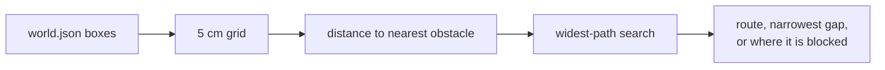

# The clearance check, explained

**Question it answers:** can a person of a given width get from Start to Goal in this room, and how wide is the best route?

It is plain code with no AI. The website version is [`web/src/clearance.ts`](../web/src/clearance.ts) (it also draws the route); a smaller Python version, [`server/labelling/clearance.py`](../server/labelling/clearance.py), lets the layout agent refuse a layout that squeezes the route.

## How it works

1. Lay a grid of 5 cm squares over the floor, inside the room bounds.
2. For each square, measure the distance from its centre to the nearest obstacle or wall. That is its **clearance**; 0 means furniture covers it.
3. A person of width W fits where clearance is at least W / 2. This is the same as making every obstacle W / 2 fatter and treating the person as a dot.
4. Find the route that keeps the most room (a widest-path search), then the shortest route that is just as roomy, and smooth it for drawing.
5. Report the walkability, the narrowest gap on the route and, if there is no route, where it is blocked.

## Rules worth knowing

| Rule | Why |
|---|---|
| `fixed`, `movable` and `climbable` objects block; `passable` ones (rugs, doors) do not | You walk over a rug and through a door |
| Objects whose underside is more than 2 m above the floor are ignored | A high shelf is walked under |
| Start or goal inside furniture is moved to the nearest cell with room, but never more than 0.5 m | Real scans often put them in furniture |
| The route prefers to stay clear of furniture when it costs little | A person does not hug a wall |
| Very large rooms get bigger cells | Keeps a phone quick |
| Preset widths are 0.5 m (walking), 0.7 m (walker) and 0.85 m (wheelchair); a slider goes from 0.4 to 1.2 m | These are estimates for planning, not measurements |

## Limits

- It works on the boxes in `world.json`, not on the scan itself, and box sizes come from a phone scan and AI labelling.
- The Python version is right to about 5 to 10 cm and reads a little narrow; gaps over 1.2 m are reported as 1.2 m.
- It is a planning aid, not an accessibility or safety assessment.

How fast it is: [performance.md](performance.md).
