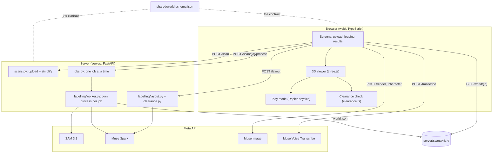
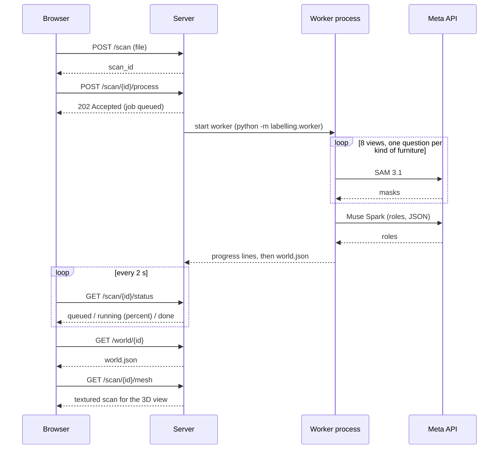

# System overview

A short tour of how Room world fits together, with the decisions behind it. It sits beside the longer, per-endpoint [architecture.md](architecture.md), which stays the detailed reference. Everything here was checked against the code.

## Data flow

## Key sequence: scanning a room

## Decisions and trade-offs

| Decision | The obvious alternative | Why we did it this way |
|---|---|---|
| A background job plus polling every 2 s | One long request | The free host is slow and hosting layers often cut a single request off at about 100 s. Polling keeps every request short and lets the loading screen show real progress. |
| One worker **process** per job | A thread, or the web server's own process | Python does not hand freed memory back, so on the 512 MB host the second scan crashed the server. A process that exits returns everything. |
| One job at a time | A parallel queue | The host cannot hold two jobs. Others wait with state `queued`. |
| Jobs kept in memory | A database | Out of scope; a restart loses jobs, and the website says so (status answers 404). |
| Furniture as **boxes** in `world.json`, but physics on the **scan's triangles** in play mode | Boxes for everything, or full meshes in the contract | Boxes are a small, easy contract for both sides and for the layout agent. The real scan makes play feel real. |
| Models **propose**, code **checks** | Trust model output | Roles must be one of four, layout moves are validated (movable only, inside the room, no overlaps, one retry), and views vote so one wrong view is outvoted. |
| Clearance and match score are **plain code** | Ask a model | The numbers need to be repeatable and explainable. See [clearance.md](clearance.md). |
| Two clearance implementations (TypeScript and Python) | One shared one | The website draws the route and needs speed in the browser; the server only needs a pass/fail to give the model feedback. The Python one is documented as right to about 5 to 10 cm and a little narrow. |
| `shared/world.schema.json` as the only handover | Sharing code | Two people could build in parallel against `shared/example_world.json`. |

## Failure modes

| What goes wrong | What happens | Where |
|---|---|---|
| Wrong file type, or over 100 MB | Rejected straight away with a plain message (400 / 413); the browser checks first | `web/src/api.ts`, `server/scans.py` |
| No `MODEL_API_KEY` on the server | Scanning, voice, layout and character return 503 / `no_key`; the ready-made rooms still work | `server/jobs.py` |
| SAM finds no furniture | Job ends with `no_objects` and a plain-English message | `server/jobs.py` |
| A few SAM questions fail | Tolerated if under a quarter; each request has a timeout and 2 retries | `server/labelling/sam.py` |
| Meta API trouble | `ai_service` error shown on the Upload screen | `server/jobs.py` |
| Worker killed (out of memory) | Job reports `out_of_memory` instead of taking the server down | `server/labelling/worker.py` |
| Worker hangs | Killed after 10 minutes | `server/jobs.py` |
| Server restarts mid-job | Status answers 404; the website says the server restarted | `web/src/api.ts` |
| Layout proposal breaks the rules | One retry with the problems as feedback, then 422 and nothing changes | `server/labelling/layout.py` |
| Browser audio is WebM/Ogg/MP4 and `ffmpeg` is missing | `/transcribe` returns 415 | `server/transcribe.py` |
| The textured scan cannot load | The viewer shows boxes only, with a message | `web/src/main.ts` |
| Play mode cannot start | Falls back to the 3D viewer with the error | `web/src/main.ts` |

## Folder map

| Path | What is in it |
|---|---|
| `web/src/` | The app: screens, viewer, play mode, physics, clearance check, layout panels, API calls |
| `web/scripts/` | Offline tests (`test-*.ts`) and the clearance benchmark (`bench-clearance.ts`) |
| `web/public/` | Ready-made rooms (`examples/`), the character image, background pictures |
| `server/` | FastAPI routes: scans, jobs, layout, characters, score, transcribe, render |
| `server/labelling/` | The pipeline: rendering views, SAM, voting, roles, layout, clearance, worker |
| `server/scripts/` | Offline tests (`test_*.py`) using fake AI answers, helper scripts, the benchmark |
| `shared/` | `world.schema.json` and example worlds: the contract |
| `docs/` | Architecture, this overview, deployment, performance, data sources, issue drafts, screenshots |
| `Dockerfile`, `render.yaml` | One image that serves the API and the website; Render Blueprint |
